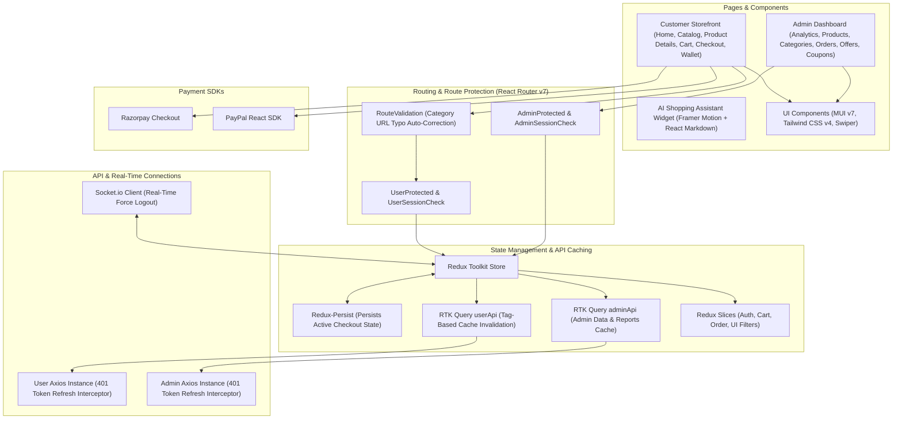
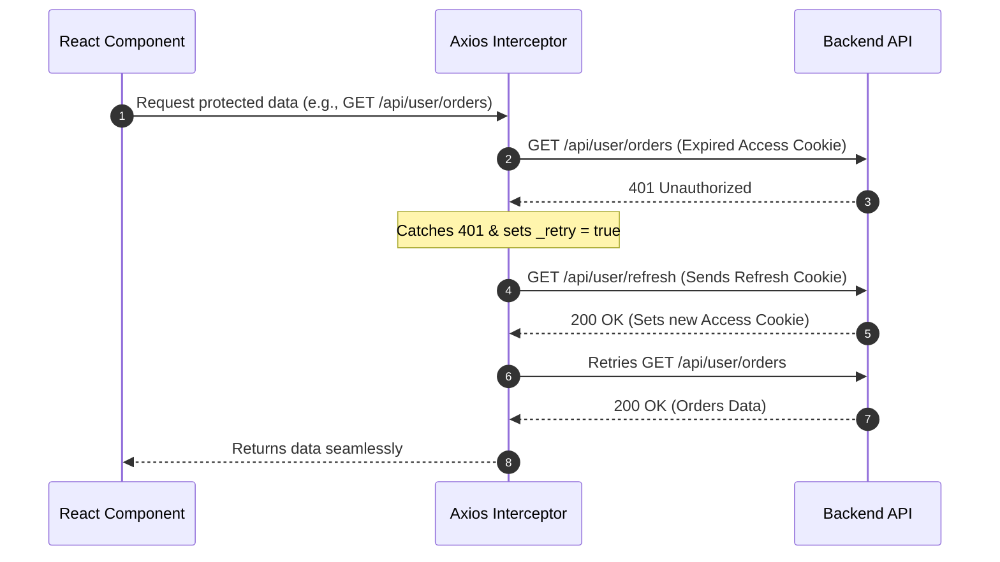

# Gratia E-Commerce Frontend (Client)

[](https://react.dev/)
[](https://vitejs.dev/)
[](https://redux-toolkit.js.org/)
[](https://tailwindcss.com/)
[](https://mui.com/)
[]()

> Frontend Single Page Application (SPA) for the **Gratia** e-commerce platform, including both the customer storefront and the admin dashboard. Built with **React 19**, **Vite 7**, **Tailwind CSS v4**, and **Material UI**, using **Redux Toolkit & RTK Query** for state management and API caching, **Axios interceptors** for automatic token refresh, **Socket.io** for real-time forced logout, and **Recharts** for admin analytics. Hosted on **AWS Amplify**.

---

## Architecture Overview

The frontend is organized into reusable UI components, protected routes, Redux/RTK Query state management, and Axios/Socket.io network layers:



---

## Key Features & Implementation Details

### 1. State Management & RTK Query Tag Invalidation
- **RTK Query API Caching**: Separate API slices for customer ([`userBaseApi.js`](src/Store/Api/setup/userBaseApi.js)) and admin ([`AdminBaseApi.js`](src/Store/Api/setup/AdminBaseApi.js)) manage data fetching, loading states, and cache invalidation using tags (`Auth`, `Orders`, `Product`, `Variants`, `Category`, `Coupons`, `Report`, etc.).
- **Automatic UI Updates**: When an admin updates a product variant or changes an order status, RTK Query invalidates the related tags and automatically refetches fresh data without needing manual page reloads.
- **Persistent Checkout State**: Uses `redux-persist` on the order slice so checkout items and selected coupons are not lost if the user refreshes the page.

---

### 2. Automatic JWT Refresh via Axios Interceptors
Authentication uses short-lived JWT access tokens and 30-day refresh tokens stored in `HttpOnly` cookies:
- When an access token expires and an API call returns `401 Unauthorized`, the Axios response interceptor ([`userInstance.js`](src/Store/Api/setup/Instances/userInstance.js)) catches the error and sets `originalRequest._retry = true`.
- It automatically calls `/api/user/refresh` (or `/api/admin/refresh`) to get a new access token cookie and retries the original failed request in the background without logging the user out.



---

### 3. Category URL Validation & Typo Auto-Correction
Category routes (`/:category/:subCategory?/:thirdCategory?`) are wrapped in [`RouteValidation.jsx`](src/Components/Protected/RouteValidation.jsx):
- Uses the `string-similarity` package (`findBestMatch`) to compare URL parameters against existing category names from the database.
- If a user types a minor typo in the URL (e.g., `/fashon` instead of `/fashion`) and the similarity score is above `0.4`, the app automatically redirects (`navigate(..., { replace: true })`) to the matching category URL instead of showing a 404 page.

---

### 4. Guest Cart to User Cart Sync
- Guests who are not logged in can add items to their cart, which is saved in `localStorage`.
- As soon as the user logs in, [`App.jsx`](src/App.jsx) reads the items from `localStorage.getItem("cart")`, sends them to the backend cart endpoint via `useAddToCartMutation`, and clears the local storage cart so their items are merged into their account.

---

### 5. Real-Time Forced Logout (Socket.io)
- When a user logs in, [`App.jsx`](src/App.jsx) emits `registerUser` with their `userId` to the Socket.io server.
- The app listens for the `forceLogout` socket event. If an admin blocks the user from the Admin Dashboard, the frontend immediately clears the Redux user state, triggers the logout API, and shows a toast notification (`"You have been blocked by admin"`).

---

### 6. Multiple Payment Options & Failed Payment Retry
- **Supported Payment Methods**:
  - **Razorpay**: Opens the Razorpay checkout modal and sends payment signatures to the backend for verification.
  - **PayPal**: Uses `@paypal/react-paypal-js` for PayPal checkout.
  - **In-App Wallet**: Allows paying directly using available wallet balance.
  - **Cash on Delivery (COD)**: Places the order directly with address validation.
- **Retry Failed Payments (`/checkout/retry/:id`)**:
  - If an online payment fails or is closed mid-checkout, the order is saved with status `"Failed"`.
  - Users can visit [`CheckoutRetry.jsx`](src/Pages/User/CheckoutRetry.jsx) from their Orders page to retry paying for that exact order using any payment method.

---

### 7. Admin Analytics Dashboard & Report Downloads
The Admin Dashboard ([`Dashboard.jsx`](src/Pages/Admin/Dashboard.jsx)) provides sales and order insights:
- **Charts (Recharts)**: Line chart for revenue/sales trends, pie chart for order status breakdown, and bar charts.
- **Date Filtering**: Filter dashboard stats and sales reports by daily, weekly, monthly, yearly, or custom date ranges using **MUI Date Pickers**.
- **Top 10 Lists**: Displays top-selling products, categories, and brands.
- **Excel & PDF Exports**: One-click buttons to download filtered sales reports in `.xlsx` or `.pdf` format.

---

### 8. Client-Side Image Cropping & Product Zoom
- **Image Cropper** ([`ImageCropper.jsx`](src/Components/Admin/ImageCropper.jsx)): Admins can crop and resize product and banner images in the browser using `react-easy-crop` and HTML5 Canvas ([`getCroppedImg.js`](src/Utils/getCroppedImg.js)) before uploading to Cloudinary.
- **Product Image Zoom**: Product detail pages include high-resolution hover zoom (`react-inner-image-zoom`) and `Swiper` image sliders.

---

### 9. Floating AI Shopping Assistant
- Built with **Framer Motion** for smooth open/close animations ([`ChatBox.jsx`](src/Components/User/ChatBox.jsx)) and **React Markdown** (`react-markdown`) to properly format bold product names, bullet points, and pricing returned by the backend Gemini AI service.

---

## Project Structure

```text
Frontend/src/
├── Assets/                      # Static images, icons & placeholders
├── Components/                  # Reusable UI components
│   ├── Admin/                   # Admin dashboard & management components
│   │   ├── AdminLayout.jsx      # Admin sidebar & layout wrapper
│   │   ├── DashBoxes.jsx        # Summary count cards
│   │   ├── ImageCropper.jsx     # Client-side image cropper modal
│   │   ├── LineGraph.jsx        # Recharts line graph
│   │   ├── OrderStatusModal.jsx # Modal to update order item status
│   │   ├── PiChart.jsx          # Order status pie chart
│   │   ├── ProductTable.jsx     # Product & variant management table
│   │   └── SalesLineGraph.jsx   # Revenue & sales chart
│   ├── Protected/               # Route protection components
│   │   ├── AdminProtected.jsx   # Protects admin routes
│   │   ├── AdminSessionCheck.jsx# Redirects logged-in admins away from login page
│   │   ├── RouteValidation.jsx  # Validates & auto-corrects category URLs
│   │   ├── UserProtected.jsx    # Protects authenticated user routes
│   │   └── UserSesssionChech.jsx# Redirects logged-in users away from login page
│   └── User/                    # Customer storefront components
│       ├── ChatBox.jsx          # Floating AI chat assistant
│       ├── Header.jsx           # Main navbar, search bar & cart badge
│       ├── PaypalButton.jsx     # PayPal button component
│       ├── ProductCard.jsx      # Product card component
│       ├── ProductZoom.jsx      # Product image zoom gallery
│       ├── Razorpay.jsx         # Razorpay payment handler
│       ├── Search.jsx           # Search input with suggestions
│       └── SelectCouponModal.jsx# Modal to view & apply coupons
├── Error/
│   └── ErrorBoundary.jsx        # React Error Boundary fallback UI
├── Layout/
│   └── MyAccountLayout.jsx      # Sidebar layout for user profile, orders & wallet
├── Pages/
│   ├── Admin/                   # Admin views (Dashboard, Products, Orders, Offers, Coupons)
│   └── User/                    # Customer views (Home, ProductListing, Checkout, Orders, Wallet)
├── Routes/
│   ├── Admin.route.jsx          # Admin route definitions
│   └── User.route.jsx           # Customer route definitions
├── Store/                       # Redux Toolkit & RTK Query setup
│   ├── Api/
│   │   ├── admin/               # Admin RTK Query endpoints
│   │   ├── setup/               # Axios instances & base query setup
│   │   └── user/                # User RTK Query endpoints
│   ├── StoreSlices/             # Redux state slices (auth, cart, order, ui)
│   └── store.js                 # Redux store & redux-persist configuration
├── Utils/
│   ├── getCroppedImg.js         # Canvas helper to crop images
│   └── ProtectedRoute.jsx       # Route guard helper functions
├── WebSocket/
│   └── socket.js                # Socket.io client setup
├── App.jsx                      # Root component (auth check, cart sync & socket listener)
├── main.jsx                     # App entry point
└── index.css                    # Global styles & Tailwind CSS v4 setup
```

---

## Main Application Routes

| Path | Component | Access | Description |
| :--- | :--- | :--- | :--- |
| `/` | `Home` | Public | Home page with category sliders, banners & product carousels |
| `/:category/:sub?/:third?` | `ProductListing` | `RouteValidation` | Category product listing with filters, sorting & pagination |
| `/search` | `ProductListing` | Public | Product search results with sidebar filters |
| `/product/:id` | `ProductDetails` | Public | Product details, variant selection, reviews & image zoom |
| `/cart` | `Cart` | Public / User | Shopping cart management |
| `/checkout` | `Checkout` | `UserProtected` | Checkout page (address, coupons & payment methods) |
| `/checkout/retry/:id` | `CheckoutRetry` | `UserProtected` | Retry payment for failed orders |
| `/myAccount`, `/orders`, `/myWallet` | `MyAccountLayout` | `UserProtected` | User profile, addresses, order tracking, returns & wallet |
| `/admin/login` | `AdminLogin` | `AdminSessionCheck`| Admin login page |
| `/admin` | `Dashboard` | `AdminProtected` | Admin analytics dashboard & sales reports |
| `/admin/products` | `Products` | `AdminProtected` | Product & variant management |
| `/admin/orders` | `AdminOrders` | `AdminProtected` | Order & item status management |
| `/admin/orders/return/requests` | `ReturnRequests` | `AdminProtected` | Approve/reject customer return requests |

---

## Local Development Setup

```bash
# 1. Install dependencies
npm install

# 2. Start Vite development server
npm run dev

# 3. Build for production
npm run build

# 4. Preview production build locally
npm run preview
```
